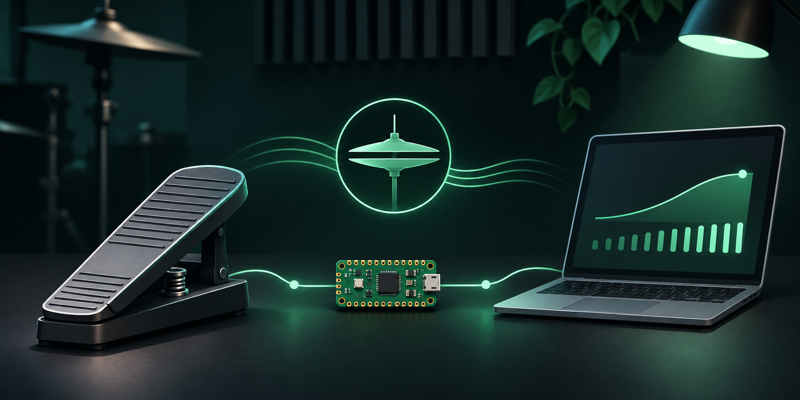
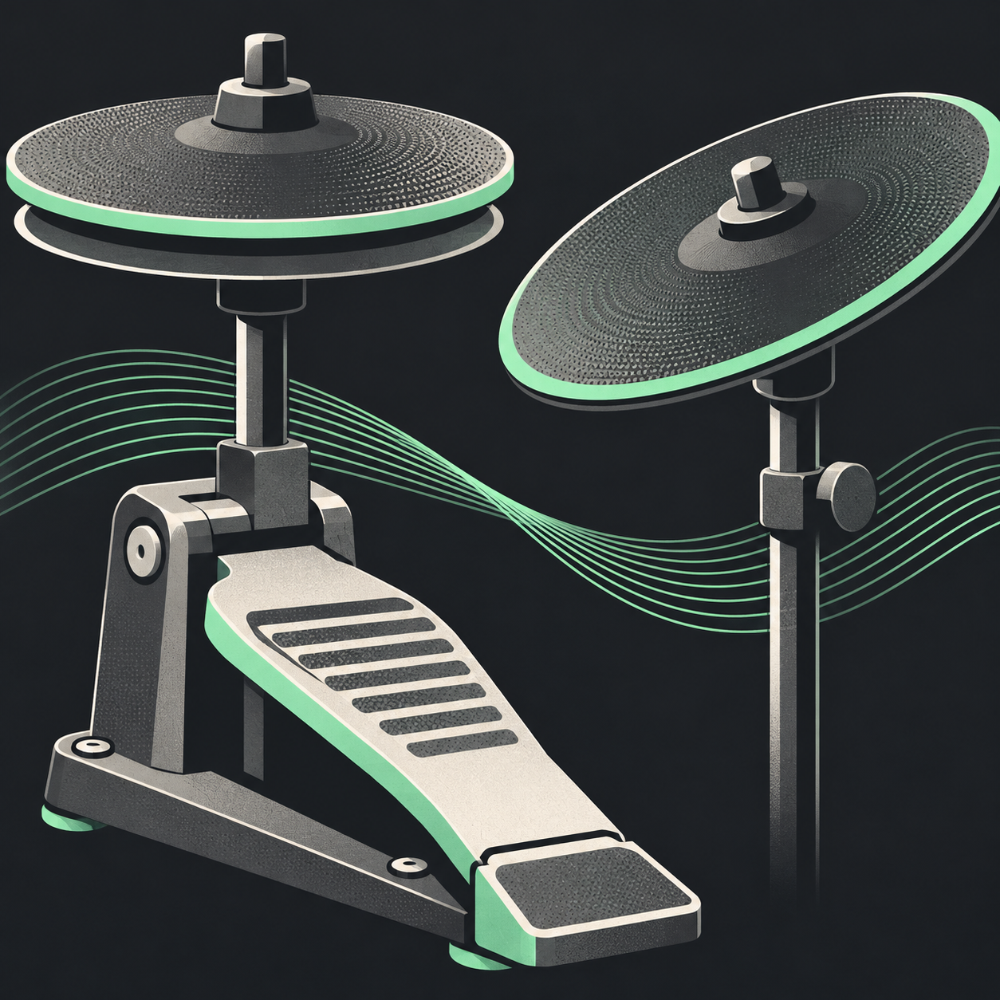

# OpenHiHat CC4



An open-source USB MIDI bridge for a continuous electronic hi-hat pedal. A Raspberry Pi Pico turns pedal movement into MIDI CC4 for a drum instrument such as Addictive Drums 2.

CircuitPython firmware for an independent USB-MIDI hi-hat position controller on Raspberry Pi Pico RP2040. It converts a calibrated analog input on GP26 into controller 4 on MIDI channel 1 by default. It sends no MIDI notes.

The software includes endpoint calibration, polarity inversion, three response curves, median and low-pass filtering, duplicate suppression, a MIDI update limit, CRC-protected persistent settings, and a USB serial console. Missing or invalid calibration disables MIDI output.

An Alesis RealHat continuous pedal was tested with a preliminary breadboard circuit. The user reported successful pedal response and foot-splash operation in Addictive Drums 2. This is one setup, not a general compatibility or production safety certification. Sampling deadlines and end-to-end latency have not been verified against the targets.

- Read [hardware limits and the measurement record](docs/hardware.md) before connecting the pedal.
- Follow [installation and recovery](docs/flashing.md) to update the firmware.
- Follow [calibration and configuration](docs/calibration.md) after the circuit is qualified.
- Follow [Logic Pro and Addictive Drums 2 setup](docs/daw-setup.md) for sound integration.
- Read [verification evidence and remaining acceptance checks](docs/verification.md) for what has actually been tested.
- Read [design choices](docs/design.md) and the [original PRD](docs/PRD.md) for scope.

## Development

To open the local test interface, run `python3 tools/web_server.py` and visit <http://127.0.0.1:8765>. The page shows the Pico's serial status and offers a separate synthetic CC4 test source named `OpenHiHat Test`. Select that source in MIDI Monitor. Synthetic messages originate on the Mac and do not demonstrate pedal or Pico output. Press Control-C in the server terminal to stop the interface.

The firmware needs no third-party CircuitPython libraries. The host tools need Python 3. USB MIDI capture uses Apple's CoreMIDI and CoreFoundation frameworks through a small C program compiled with `clang`.

Run the automated behavioral tests from the project root.

```sh
python3 -m unittest discover -s tests -v
```

Inspect the device's running serial console.

```sh
python3 tools/pico_console.py --command status
python3 tools/pico_console.py --command help
```

The original Pico runtime is CircuitPython 7.3.3. On that version the MIDI source uses the default `Pico` name. `boot.py` uses `OpenHiHat CC4` on runtimes that expose the naming APIs. The sampling target is 1,000 Hz. The default CC rate limit is 250 messages per second. These settings are not measured latency guarantees.

The firmware lives under `firmware/`. Behavioral tests live under `tests/`. Installation and hardware verification tools live under `tools/`. Local backup files live under `backups/`, excluded from Git. Test transcripts and installed hashes live under `artifacts/`, also excluded from Git.

New source is available under the [MIT license](LICENSE). The backed-up programs and libraries retain their original licenses.


